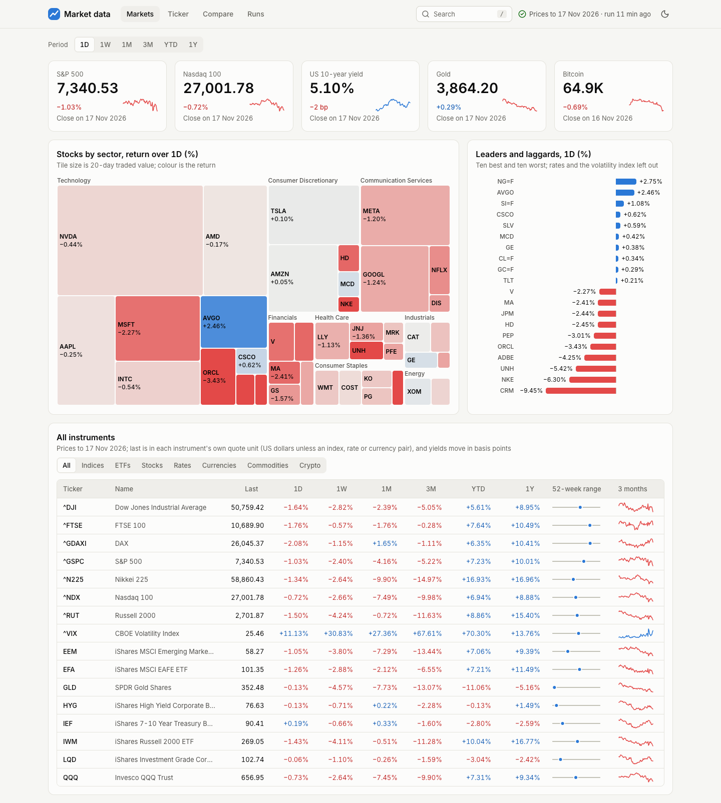

# market-data-public

A nightly job that fetches daily prices for about 680 instruments (the S&P 500 and a curated set of indices, rates, ETFs, currencies, futures and coins) from Yahoo Finance with `yfinance`, stores them in MotherDuck, and shows them on a dashboard that reads the store live through a small API; a throwaway end-to-end test.

**Live dashboard: <https://henrymckay.github.io/market-data-public/>**
**Live API: <https://market-data-api.henrymckay.workers.dev/>** (its docs page)



## Run it

Python 3.14 and `uv` are needed.
The MotherDuck token goes from the macOS keychain into the one command's environment, never into a file:

```bash
uv sync
motherduck_token="$(security find-generic-password -a "$USER" -s motherduck-token -w)" \
  uv run market-data-cli nightly --log-level info
```

A path in `MARKET_DATA_DATABASE` runs everything against a local DuckDB file and needs no token:

```bash
MARKET_DATA_DATABASE=/tmp/market.duckdb uv run market-data-cli fetch AAPL MSFT
```

- `nightly` fetches every active instrument in the universe (`src/market_data/data/transform/universe.csv`): its last month, or its whole history where the store has none, its newest stored day is over 25 days old, the last month contradicts the store (a restated close, a new dividend or split) or `--full` is given.
- `fetch TICKER...` fetches only those instruments, the same way; `fetch` and `nightly` take `--full`.
- `universe sync` brings the S&P 500 rows of the CSV in line with Wikipedia's list and prints `added,removed` counts; `--check` changes nothing and exits 1 when the CSV is out of date.
- `signals` recomputes every pivot, signal, outcome, base rate and structure over every stored bar, replaces the five tables in one transaction and prints its manifest row; `--rules PATH` reads another rules file, and `--dry-run` writes nothing and prints the base rates for every asset class and grade (`event,timeframe,horizon,n,hit_rate,baseline_hit,edge,held_rate`), `--format table` aligned.
- `compute` recomputes every metric from the stored bars; `nightly` runs `fetch`, then `signals`, then `compute`, reading the bars once for the last two.
- `notify` sends the night's alerts to the ntfy topic (see Alerts) and prints one CSV row per message, `kind,title,signals,status`; it exits 0 when every send succeeded or nothing was due, 1 when any failed, 2 when `NTFY_TOPIC` is not set. `--dry-run` needs no topic, sends and records nothing, and prints every message whole as CSV, or laid out for a person with `--format table`.
- `status` shows `key,value` rows (last run, outcome, age in hours, failed items, instruments with no bars, stale) and exits 1 when a source's last run did not store or the last stored `yahoo` run is over two days old; `--alert` also sends a health message when that verdict changed since the last one, and needs the topic.
- `fetch`, `signals`, `compute` and `nightly` print the manifest rows as CSV with one header, one row per stage; logs, including each failed instrument by name, go to standard error.
- Exit codes: 0 every instrument stored, 1 any `partial` or `failed`, 2 a usage or configuration error such as a missing token.

`.github/workflows/nightly.yml` runs at 02:17 UTC every day and on demand.
Its `nightly` job runs `nightly`, then `status`, and holds the repository secret `MOTHERDUCK_TOKEN` (as `motherduck_token`).
It passes `--full` on Sundays, and on demand with the `full` input.
Its `warm` job holds no secret: it waits up to 20 minutes for `/api/latest`'s `version` (the end of the last stored `signals` or `metrics` run) to reach the run, then requests `/api/overview`, `/api/runs` and the `/api/bars/{slug}` of every featured instrument, so no visitor waits on a cache miss for the headline screens, and fails on any status but 200.
`.github/workflows/universe.yml` runs `universe sync` at 06:00 UTC on the 1st of each month and commits `universe.csv` to `main` when it changed; its `keepalive` job enables the scheduled workflows again through the API, so GitHub's 60-day idle rule does not disable them.
`.github/workflows/site.yml` builds `web/` and publishes it to GitHub Pages on a push to `main` that touches `web/`, with `VITE_API_URL` from the repository variable `API_URL`.
`.github/workflows/api.yml` tests the Worker on every push touching `api/` and deploys it from `main` with the repository secrets `CLOUDFLARE_API_TOKEN`, `CLOUDFLARE_ACCOUNT_ID` and `MOTHERDUCK_API_TOKEN` (the read-only service account's token, uploaded as the Worker secret `MOTHERDUCK_TOKEN`).
`.github/workflows/verify-secrets.yml`, run by hand, counts each token in every run log, the published site and a `wrangler tail` session, and prints only the counts.

Run it by hand with `gh workflow run nightly.yml --ref main`.

Every night replaces each answering instrument's rows from the first day it fetched, so a re-run is safe and leaves the same rows.
The log's `Store busy for N s` line is the nightly's MotherDuck usage.

## Signals

`signals` finds swings, trend changes and their base rates on daily, weekly and monthly bars; the rules are in `src/market_data/data/transform/monitor.yaml`, and each signal and base rate carries the first 12 hex digits of their SHA-256 as `rules`.
A swing high (low) is a high (low) that a later close retreated from by `k` times the 14-bar ATR; it is confirmed on that close and never moves, so no signal repaints.
A signal is a `break_up` (in a downtrend, a close above the last lower high), its `confirm_up` (the next swing low confirmed above the downtrend's last low) or its `fail_up`, and the mirrors; weekly and monthly bars count once their period has ended.
Tables written by `signals`:

- `pivots`: every confirmed swing, labelled `HH`, `LH`, `EH`, `HL`, `LL` or `EL` against the one before.
- `signals`: one row per signal, with its level, stop, score, grade, the higher timeframe's alignment and what it has done since.
- `outcomes`: each signal's return, best and worst excursion and whether its stop held at each horizon.
- `signal_stats`: base rates per event, timeframe, asset class (or `all`), grade (or `all`) and horizon, with the any-bar baseline and the `edge` over it.
- `structure`: each instrument's trend state on each timeframe, which `overview` carries as `trend_d`, `trend_w` and `trend_m`.
- `period_bars`: the view of weekly and monthly bars the swings are found on.

The base rates are in-sample and over today's index members, so they overstate what a live signal would have done.
Compare a rules change before committing it by running `signals --dry-run` under each file.

## Alerts

`notify` sends the owner's phone, over [ntfy.sh](https://ntfy.sh) used anonymously, what the `signals` stage found in the last four days that no earlier message named:

- A **push** for each signal graded A (at most ten a night, best first) with a chart of the timeframe's last 80 bars, the level dashed, the stop dotted and the signal bar marked. The title is the verdict (`NVDA weekly: first higher high (A)`), the message at most four lines: the close or swing and its margin, where it is proved wrong, the volume and the next timeframe up's trend, and the base rate beside the any-bar baseline. A tap opens the dashboard's Ticker view at the signal (the page ignores the parameters until M11); two buttons open the chart and that day's signals.
- A **digest** for each asset class with a signal graded B or better, ranked, at most 12 lines, ending in a count of what it leaves to the Signals screen. A class whose signals were all pushed gets none. Grade C signals and failures are never sent.
- A **health** message, only when the pipeline's state changes: `Market data: nightly partial` (or `failed`, `stale`) with the failing stages and a link to the Actions run, then `Market data: healthy again`. `status --alert` runs it at 09:47 UTC from `watch.yml`, so a night that never ran is reported too.

The base rates are in-sample and show little or no edge over any bar; read the baseline beside each.
Each signal is sent once: `notify` appends an `alerts` row per signal a message named, and sends only signals without one.
A message ntfy refuses after two retries gets no row, so the next night sends it again while it is recent; a push whose chart fails to draw or upload goes as text.

**Subscribe** once: install the ntfy app (no account), then copy the topic without showing it and paste it as a new subscription on server `ntfy.sh`:

```bash
security find-generic-password -a "$USER" -s ntfy-market-monitor -w | pbcopy
```

The topic is the only key to the channel, so never post it; `scripts/make_topic.py` made it once (it refuses to replace one without `--rotate`, which means subscribing again) and set the repository secret `NTFY_TOPIC`.
`nightly.yml`'s `notify` job and `watch.yml` hold it in their run step's environment; every job also pings the topic when a step before its command fails.
`verify-secrets.yml` counts it, whole and in fragments, in every run log and the published site.
Look at what a night would send with `market-data-cli notify --dry-run --format table` and the token in the environment.

## Dashboard

A Vite, React and TypeScript app in `web/`; Node comes from `nodejs-wheel` through `uv`, so none is needed on the system.

The page fetches JSON from the API named by `VITE_API_URL` when it is built, so run the API first (below), then:

```bash
uv sync
uv run npm --prefix web ci
VITE_API_URL=http://127.0.0.1:8787 uv run npm --prefix web run build
uv run npm --prefix web run preview    # http://127.0.0.1:4173/
```

The API only answers pages from the origin in its `ALLOWED_ORIGIN`; for the preview, start it with `-- --var ALLOWED_ORIGIN:http://127.0.0.1:4173` after `npm run dev`.
A slow API shows a "still loading" note and a failed one an error with a retry; the rest of the page keeps working.

Four screens: Markets (its table of every instrument pages at 100 rows), Ticker, Compare and Runs; every view is a link (`?view=ticker&t=AAPL&range=5Y`), `/` opens the search, and the page follows the system's light or dark scheme.

## API

`api/` is a Cloudflare Worker, <https://market-data-api.henrymckay.workers.dev/>, that answers the dashboard's reads from MotherDuck through a cache (Workers KV, keyed by the last stored run, refreshed by a cron every 15 minutes).
It is read-only: its MotherDuck user is a service account that sees `market_data` only through a read-only share.
The root path is the docs page.

| Method | Path | Returns |
|---|---|---|
| GET | `/api/latest` | the last stored `yahoo` run and the data `version`, or `null` |
| GET | `/api/overview` | one object per instrument: identity, coverage, every metric, a 63-bar sparkline |
| GET | `/api/runs` | the last 90 runs, newest first |
| GET | `/api/bars/{slug}` | one instrument's whole history, oldest first, as columns |

```bash
curl -s https://market-data-api.henrymckay.workers.dev/api/latest
```

```json
{"day":"2026-11-17","ended":"2026-11-18T06:39:02Z","outcome":"stored","rows":833631,"version":"2026-11-18T06:47:30Z"}
```

An unknown slug is `404` with `{"error": "...", "code": "not_found"}`; MotherDuck being unreachable is `503` with `Retry-After`.
Only the dashboard's origin gets CORS headers.

Run it locally against the store, the token going from the keychain into that one process and nowhere else:

```bash
cd api && uv run npm ci
CLOUDFLARE_INCLUDE_PROCESS_ENV=true MOTHERDUCK_TOKEN="$(security find-generic-password -a "$USER" -s motherduck-token -w)" uv run npm run dev   # http://127.0.0.1:8787/
```

`compute` writes the `overview` table the Worker reads, so run it (or `nightly`) once before the first request.

## Develop

```bash
uv run pytest
uv run ruff check && uv run ruff format --check
uv run pyright
uv run pytest -m real   # one run against Yahoo itself
uv run npm --prefix web run typecheck && uv run npm --prefix web run lint && uv run npm --prefix web test
uv run npm --prefix api run typecheck && uv run npm --prefix api run lint && uv run npm --prefix api test
VITE_API_URL=http://127.0.0.1:8788 uv run npm --prefix web run build   # the smokes' stub API listens on 8788
CHROME="/Applications/Google Chrome.app/Contents/MacOS/Google Chrome" uv run pytest -m slow   # browser smokes over web/dist
```

## Query the store

The data sits in the MotherDuck database `market_data`; open it with the token in the environment (`motherduck_token="$(security find-generic-password -a "$USER" -s motherduck-token -w)" duckdb md:market_data`) and run:

How many bars and instruments are stored:

```sql
select count(*) as bars, count(distinct ticker) as tickers from bars;
```

An instrument's latest five closes:

```sql
select day, close, adj_close from bars where ticker = 'AAPL' order by day desc limit 5;
```

The ten best instruments over one month:

```sql
select ticker, value as return_1m from metrics where metric = 'return_1m' order by value desc limit 10;
```

The base rates of every event over all instruments, best edge first:

```sql
select event, timeframe, horizon, n, hit_rate, baseline_hit, edge from signal_stats where asset_class = 'all' and grade = 'all' order by edge desc limit 10;
```

The newest signals, graded:

```sql
select ticker, timeframe, event, day, grade, score, level, stop from signals order by known desc, score desc limit 10;
```

The instruments whose weekly structure is up:

```sql
select ticker, since, last_high, last_low from structure where timeframe = 'w' and state = 'up' order by ticker;
```

The last five nightly runs:

```sql
select ended, source, outcome, failed_items, rows from runs order by ended desc limit 5;
```

## Tear it down

Each step is irreversible, so run them yourself when the test is over:

```bash
gh repo delete henrymckay/market-data-public --yes        # the repository, its Actions runs, the secret and the Pages site
motherduck_token="$(security find-generic-password -a "$USER" -s motherduck-token -w)" \
  duckdb md: -c "drop database market_data"               # the stored data
security delete-generic-password -a "$USER" -s motherduck-token   # the local copy of the token
```

Then revoke the token in MotherDuck's settings (Settings, Access tokens), since the repository secret held a copy of it.

The API adds its own pieces, which `gh repo delete` does not reach:

```bash
motherduck_token="$(security find-generic-password -a "$USER" -s motherduck-token -w)" \
  duckdb md: -c "drop share market_data_api"              # the read-only share
curl -X DELETE https://api.motherduck.com/v1/users/market_data_api \
  -H "Authorization: Bearer $(security find-generic-password -a "$USER" -s motherduck-token -w)"   # the service account and its token
```

- Delete the Worker `market-data-api` and the KV namespace `market-data-api-cache` in the Cloudflare dashboard (Workers & Pages), or with `npx wrangler login` and `npx wrangler delete` in `api/`.
- Revoke the Cloudflare API token under My Profile, API Tokens.
The schedule is disabled by GitHub after 60 days without repository activity, so a forgotten copy stops itself.
